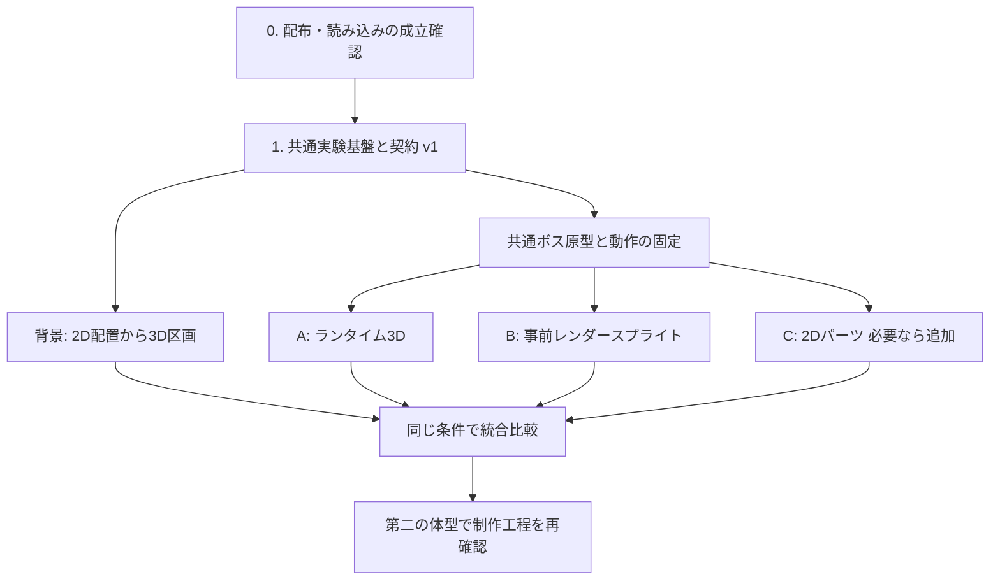

# HD-2D風の背景・大型キャラクター実験計画

調査日：2026年11月26日 JST。状態：背景表示の共通基盤と街・森の試作を実装済み。キャラクター方式の比較、GLBのアニメーション読込、実機性能の選定は後続。以下の日数・容量・フレーム時間は見積もりと初期目標で、実測値ではない。

配信経路：既存Cloudflare本人専用Workerの`/hd-2d/`を使用する。配信確認用の入口とHTML集約経路を先に整備し、実験本体の実装後も同じコマンドで更新する。[ビルド・配信手順](../hd-2d/README.md)

選定条件：**商用利用を含め、購入・月額契約・売上に応じた利用料が不要なツールだけを候補にする。** 非商用限定の無料版、期間限定の体験版、有料アドオンや従量課金APIを必要とする工程は採用しない。過去の調査資料に含まれる有料製品も、今回の採用候補から除外する。

## 1. 推奨方針

**Babylon.js＋TypeScriptで小さな共通実験室を作る。背景は「2Dの配置データ＋高さ・形状の指定」から3D化する。キャラは同じオリジナルの立体原型から、ランタイム3Dと事前レンダースプライトを比較する。2Dパーツ方式を低工数の対照として加える。**

大型キャラで重くなるのは、画像の大きさそのものより、方向別・動作別の絵と、その修正を作り続ける工程。立体を制作に使えば、最終表示が2Dでも、その負担を減らせる。一方、自由な回り込み・動的な陰影・部位の奥行きが必要なら、ランタイム3Dが有利になる。最初から表示方式を一つに固定せず、同じ被写体で確かめる。

最初の制作原型は、部位を硬いまま動かす低ポリモデルを推奨する。ボクセルはその形状を作る別の手段として試し、最初から「全身を1ピクセルずつ立体化する」ことは必須にしない。顔や関節で連続した変形が必要になった場合に、スキニングを追加する。

既存の[2D→3D制作調査](2d-assets-to-animated-3d-survey-2026-11.md)はPlayCanvasを先行候補としている。今回は「HD-2D風の絵作りと大型ボスの比較」に目的を絞り、ポスト処理・影・モデル再生をまとめて試せるBabylon.jsを先行候補にする。PlayCanvasの不採用を確定する判断ではない。

## 2. 添付画像から目標を分解する

公式はHD-2Dをドット絵と3DCGの画面効果を組み合わせた表現と説明している。[OCTOPATH TRAVELER公式](https://www.jp.square-enix.com/octopathtraveler/about/)

次は添付画像の観察から立てる制作上の仮説であり、原作の内部実装を断定するものではない。

| 要素 | 実験すること |
| --- | --- |
| 小さなドットキャラと立体の街並み | キャラ・背景の輪郭とテクセル密度をそろえる。画面全体のモザイク化だけで済ませない |
| 建物・橋・階段の奥行き | 単純な3D形状と小さなテクスチャで、前後関係と落ち影を作る |
| 暖色の光と暗い周辺 | キーライト、環境光、色調整、弱いビネットを個別に調整する |
| 手前・奥のぼけと中央の読みやすさ | 被写界深度は後から加え、キャラ・攻撃予告の判読性を保つ |
| 煙・光・小物による密度 | 輪郭と陰影が成立してから足す。最初の完成条件にはしない |

第一段階は固定に近い斜め見下ろしカメラ。正投影と狭い画角の透視投影を短く比較し、一つを基準に固定する。自由回転は要求しないが、限界を調べるため左右15度と1.5倍・2倍の寄りを診断用に残す。フィールド用とボス用の2構図を用意し、スプライトを書き出す際にも投影・傾き・向きを記録する。

街と森は現代風ではなく、中世の木組み・石畳・橋・暖かな窓灯、古い遺跡や小川を持つファンタジーとする。今回の手続き的テクスチャは材質色（albedoに相当）と細部を中心にし、日差しや建物の方向性のある落ち影を焼き込まない。細かな溝の色の差は素材に含めても、昼夕の光は3Dの照明で比較する。これは今回の制作方針であり、原作アセットの内部仕様についての確認ではない。

主人公とボスで表示方式をそろえる必要はない。小さな主人公は既存の自作2D素材を比較用に置き、ボスだけを立体化してもよい。フィールドと戦闘で表現を変える案も残す。

## 3. エンジン選定

| 候補 | 今回に合う点 | 初回の扱い |
| --- | --- | --- |
| **Babylon.js** | TS/ES modules、3Dモデル・アニメーション・影・ポスト処理を組み合わせられる | 第一候補。WebGL 2で小さく始める |
| **Three.js** | 描画の構成を細かく制御でき、公式にピクセル描画の追加パスもある | Babylonの合成処理や配布容量が障害になった場合の次候補 |
| **PlayCanvas Engine** | エディタを使わずローカルJS/TSで制作可能。過去調査との連続性がある | MITライセンスのEngine単体を対象とする。有料のクラウド機能には依存しない |
| **Godot** | シーン・アニメーションをエディタで調整する制作に向く | 無料の比較候補。ただし今回はTSと単体HTMLを優先。通常Web出力は複数ファイル |

Babylonの標準パイプラインにはBloom、被写界深度、色調整等がある。ThreeにもRenderPixelatedPassがある。いずれも「HD-2Dを自動で完成させる機能」ではなく、構成要素として使う。[Babylon公式パイプライン](https://doc.babylonjs.com/features/featuresDeepDive/postProcesses/defaultRenderingPipeline/)、[Three公式ピクセルパス](https://threejs.org/docs/pages/RenderPixelatedPass.html)

BabylonのES modulesはバンドラーを前提にできる。PlayCanvasのローカル利用も公式に案内されている。[Babylon ESM](https://doc.babylonjs.com/setup/frameworkPackages/es6Support/)、[PlayCanvas単独利用](https://developer.playcanvas.com/user-manual/engine/standalone/)、[Godot Web出力](https://docs.godotengine.org/en/stable/tutorials/export/exporting_for_web.html)

### 無料の構成と除外対象

推奨構成は、Babylon.js＋Blockbench＋Blender＋手書きマップJSON。配置編集が必要になったらTiled、ボクセル造形が必要になったらMagicaVoxelを加える。TiledとLDtkはいずれも無料・オープンソースとして提供されている。[Tiled公式](https://www.mapeditor.org/)、[LDtk公式](https://ldtk.io/)

Babylon.jsはApache-2.0、PlayCanvas EngineはMITライセンスの本体を使う。無料枠付きの有料クラウドサービスを前提とする構成にはしない。[Babylonライセンス](https://github.com/BabylonJS/Babylon.js/blob/master/license.md)、[PlayCanvas Engineライセンス](https://github.com/playcanvas/engine/blob/main/LICENSE)

RPG Paper Maker、RPGツクールU2U、RPG Developer Bakin、RPG in a Boxは今回の候補から除外する。RPG Paper Makerは非商用なら無料だが、商用にはライセンス購入が必要なため、今回の無料条件には含めない。[RPG Paper Maker公式](https://rpg-paper-maker.com/)

**今回の実験はBabylon.js一本で行う。エンジンの並列移植はしない。** まず配布と描画の条件を満たすかを確認し、失敗した条件を明示して次候補へ進む。エンジンの変更だけで、造形・関節・アニメーション制作が不要になるわけではない。

## 4. 背景：2D配置データから組み立てる

「2Dマップ」は最初に広大なワールド全体を作る意味ではなく、町・戦闘場面を定義する配置データとして扱う。まず24×24セル程度の小区画だけ作る。

```text
2D配置JSON
  地面・通行可能領域
  高さ・階段・橋の階層
  建物/木/柵等の種類・向き・寸法
  マテリアル・テクスチャ・光源
       ↓ 決定論的な変換
平面＋箱＋屋根＋階段＋薄い面のメッシュ
       ↓ 必要な対象だけ追加
小物のボクセル形状 / 手作業のGLB
```

2Dの完成画像だけでは、橋の下、屋根の裏、建物の高さは決まらない。高さ、形状種別、通行面、装飾面を別データにする。特に橋の上下は単一の高さマップでは表せないため、レイヤーまたは別オブジェクトとして記述する。

初回は小さな手書きJSONで十分。配置編集が負担になった時点でTiledのJSONとカスタムプロパティを採用し、独自の入力仕様へ変換する。LDtkもJSON出力を持つが、最初から両対応しない。[Tiled JSON](https://doc.mapeditor.org/en/stable/manual/export-generic/)、[Tiledプロパティ](https://doc.mapeditor.org/en/stable/manual/custom-properties/)、[LDtk JSON仕様](https://ldtk.io/docs/)

変換器は「任意の2D絵を完全な3D街へ変換」するものではなく、意味を持った配置を少数の形状へ置き換えるもの。床・壁・屋根を別面にしてUVを割り当てる。全景をボクセル化すると箱数と面数が増えやすいため、見えない面の削除や結合を行い、1ボクセル1描画物を避ける。

背景担当の納品条件は、地面、段差、橋またはアーチ、屋根付き建物、前景の柱、点光源が一つずつある区画。経路探索や広域ストリーミングは初回対象にしない。判定は描画メッシュから独立した地面上の簡単な2D領域にする。

## 5. キャラ：同じ原型から三方式を比較する

共通の題材は、主人公の4〜6倍の背丈を持つオリジナルの「樹皮の巨人」。胴、頭、左右の腕・脚、枝の角、手前へ伸びる大きな腕を持たせる。硬い部位でも成立し、輪郭・関節・奥行きの問題を観察しやすい。特定作品のボス絵は素材に使わない。

| 方式 | 制作と表示 | 得たい答え | 主な限界 |
| --- | --- | --- | --- |
| **A：部位別の低ポリ3D** | Blockbench/Blenderで原型・動作→GLB→Babylonで再生。小さなテクスチャと限定した色・陰影を使う | 大型ボスを立体で動かしつつ、求めるドット感と制作速度を両立できるか | 単に解像度を下げても手描きの輪郭にならない。関節、陰影、動作中のちらつきが課題 |
| **B：3Dから事前レンダー** | Aと同じ原型・動作を決めたカメラでPNG連番化→アトラス→3D空間の面で再生 | 3D制作によって、大きな2D絵の描き直しをどこまで減らせるか | 視点別・動作別の画像数、手修正、動的照明とのずれ。身体全体は一枚の面の深度になる |
| **C：2Dパーツ／限定的な厚み** | 原型から切り出した部位絵を、親子関係と支点で動かす。必要なら薄い立体にする | 固定構図のボスなら、さらに少ない工数で説得力が出るか | 強いひねりや手前への攻撃、隠れた部位、描画順の調整が増える |

最初にAを通常の3D表示で成立させ、Bの書き出し元にも使う。A/Bを必須、Cは両者の制作費を見て加える。ボクセル版はAの造形差分として扱い、表示方式と造形方式を一度に増やさない。

### ツールの役割

- **Blockbench：** 無料で、制作したモデルを商用プロジェクトにも使える。低ポリの部位・階層・動作を作る入口。アニメーションを運ぶ形式はglTF/GLBを基準とし、OBJで動作まで渡せるとは扱わない。選んだプロジェクト形式・書き出しで階層と動作が残ることを一体目で確認する。[無料・商用利用の公式FAQ](https://blockbench.net/wiki/blockbench/faq/)、[形式の公式比較](https://www.blockbench.net/wiki/guides/export-formats/)
- **Blender：** 商用を含め無料で使える。原型の修正、リグ、動作、PNG連番のレンダー、GLB出力を担う。初回は複雑な変形より部位の回転を優先する。[公式の利用条件](https://www.blender.org/about/)、[glTF出力](https://docs.blender.org/manual/en/latest/addons/scene_gltf2.html)、[連番出力](https://docs.blender.org/manual/en/latest/render/output/animation.html)
- **MagicaVoxel：** 作者があらゆるプロジェクトでの無料利用を認めているボクセル形状の制作候補。静的なOBJ等の出力と、ゲーム用の骨・動作が完成していることは分けて扱う。[公式](https://ephtracy.github.io/)、[作者の利用条件回答](https://github.com/ephtracy/ephtracy.github.io/issues/331)
- **Cの2Dパーツ／厚み：** 部位面・支点・動作JSONを実験基盤で処理するか、Blenderで部位を配置して書き出す。SpriteStack、Spine、RPG Makerの3Dキャラクターコンバーターは有料ツールのため候補から除外する。

従量課金の画像生成・画像→3D・自動リグAPIも今回の候補から外す。すでに用意できている原案やモデルは、出自と利用条件を確認して同じA/B/Cへ投入できる仕様にする。

### Bの画像量は先に見積もる

仮に256×256 RGBAを1方向あたり48フレーム、4方向使うと、生の画素は約48 MiB。512×512なら約192 MiBになる。PNGのファイル容量とは別に、展開後のGPUメモリと、追加テクスチャ・mipmap分を考える必要がある。

初回はボス用の1方向から開始し、必要なら逆向きやフィールド用を追加する。アトラスは実機の最大テクスチャ寸法に合わせて分割し、余白と足元原点を統一する。安易な左右反転で、非対称の装備や照明を壊さない。

### 影と遮蔽を比較条件に入れる

事前レンダーで固定できるのは自己陰影や身体内部の重なり。世界の建物・プレイヤーとの遮蔽まで正しく固定できるわけではない。B/Cも3Dシーン内の面として描き、透明部分はalpha testを基本とする。接地影は別の簡単な影で開始する。

板が通常の不透明物と前後することと、腕・胴・足が異なる深度で前後することは別の条件。後者が必須になれば、部位分割、深度画像、代理の3D形状などが必要になる。その追加工数もB/Cの評価に含める。影を受けるだけで平面上の陰影が不自然になる場合も記録する。

## 6. 共通実験基盤の仕様

### 最小の画面

灰色の床、階段、遮蔽確認用の柱、比較用の主人公、仮ボスから始める。方式A/B/C、動作、カメラ、光源、描画効果を切り替え、停止・コマ送り・同じ時刻へのリセットを行えるようにする。横に同時表示すると負荷が変わるため、性能測定は一方式ずつ行う。

タッチでもすべての切替を使えるUIにし、設定をJSONで保存・復元する。画面保存は同じ設定・動作時刻で行い、作品としての見た目と、効果を外した検査画像を両方残す。

### 先に固定する契約

| 項目 | 初期仕様案 |
| --- | --- |
| 座標 | 右手系、Y上、XZが地面。モデルの前方は+Z、足元中央が原点。読み込み時の変換はアダプターで一度だけ行う |
| 縮尺 | 主人公の高さ1、巨人の高さ5を基準。視線・足元・描画範囲・判定範囲を別に持つ |
| 動作 | `idle`、`windup`、`attack`、`hit`、`defeat`。合計4秒の攻撃タイムラインを共有し、命中時刻はイベントで渡す |
| カメラ | 投影・画角または正投影幅・傾き・注視点・距離を共通設定化。各方式が勝手に変更しない |
| 色と解像度 | 同じパレットと基準画面を使用。主人公とボスで世界あたりのピクセル密度を合わせる。見た目評価と低負荷設定は分ける |
| 納品形式 | Aはテクスチャ込みGLB、BはPNG＋フレームJSON、CはPNG＋部位・支点・動作JSON。制作元ファイルと出典台帳も残す |
| 読み込み | `create(context)`→インスタンス。位置・向き・動作・時刻を外から指定でき、方式変更時に`dispose()`できる |
| マップ | 2D配置、高さ/通行面、遮蔽物、光源、出現位置。描画とゲーム判定を分離 |

骨の構造は全キャラで共通化しない。巨人・四足・触手は骨格が違うため、共通にするのは動作名・時刻・イベント・座標の契約まで。異なる骨格へのモーション流用は後続実験とする。

### 描画効果を足す順序

1. 通常のメッシュ、最寄り補間の小さなテクスチャ、固定ライト、接地影だけで輪郭を評価する。
2. 色段階を絞ったマテリアル、低解像度レンダーを個別に比較する。カメラ移動・関節回転によるピクセルのちらつきも見る。
3. 弱いBloom、色調整、最後に被写界深度を追加する。UIは処理後に重ねる。
4. キャラだけを低解像度化する必要が出たら専用RenderTargetと深度を扱う。画面に後から貼るだけでは建物との遮蔽・ぼけが崩れるため、別の実験として見積もる。

Nearest補間は拡大をくっきりさせる機能で、3Dの陰影や輪郭を自動でドット絵へ設計し直す機能ではない。原寸・移動中・寄りのすべてで確認する。

## 7. リポジトリと単体HTML

設置先はリポジトリ直下の **`hd-2d/`** とする。`3min-rpg/`と並ぶ独立した実験プロジェクトとして、依存・ビルド・出力を分ける。以下は当初の責務整理。次段階で実際に分割するパスと確認用URLは、実装後の調査を反映した節11の案を優先する。

```text
hd-2d/
  README.md                   # 方針・計画書への入口
  src/                        # 初回実装：契約、マップ、材質、立体生成、viewer
  scripts/build.mjs           # 初回実装：esbuildで自己完結HTMLを生成
  tsconfig.json               # HD-2D専用の型検査
  common/                     # 基盤担当：カメラ、照明、素材読込、比較制御
  contracts/                  # 親＋基盤担当：確定後は勝手に変えない
  assets/source/              # 共通原型。最初の担当が作り以後は版を固定
  maps/                       # 背景担当
  characters/runtime-3d/      # A担当
  characters/prerender/       # B担当
  characters/parts-2d/        # C担当（追加時）
  viewer/                     # 基盤担当：比較UIと測定
  tools/                      # 書き出し・埋め込み。用途別に所有者を指定
  tests/                      # 変換・アセット契約・配布物の検証
  results/                    # 同条件の画像、測定JSON、制作時間
  dist/index.html           # 外部通信不要の配布物（Git追跡対象外）
```

現行の`3min-rpg/scripts/build.mjs`は相対の名前付きimportだけを束ねる小型パッカーで、npmのエンジンをそのまま読めない。HD-2D実験には**`hd-2d/`内にesbuildの独立したビルド経路**を持たせる。既存作品のビルド全体を移行する必要はない。ルートの`build`・`test`・`typecheck`は引き続き`3min-rpg/`向けとし、HD-2D用は`hd2d:build`・`hd2d:test`・`hd2d:typecheck`で実行する。依存はリポジトリルートのmanifestとlockfileで固定する。

初回の背景表示実装は`src/`内の小さなモジュールに分ける。上の`common/`や`characters/`等は今後の分離案で、空のディレクトリを先に量産しない。Babylon.js 9.37.2、esbuild 0.28.2を固定し、JavaScriptとシェーダーをIIFEにまとめてHTMLへ内包する。

Cloudflareへの配布では、既存ゲームのHTMLをサイト直下、HD-2DのHTMLを`/hd-2d/`配下へ集約する。`cf:check`で両プロジェクトをビルド・検証し、`cf:deploy:private`で同じ本人専用Workerへまとめて更新する。ソース・認証情報を含めず、配布ディレクトリ直下の自己完結HTMLだけを対象とする。新しいホスト名や一般公開の経路は作らない。

`hd-2d/common/`はこの実験内の共有処理。既存試作との共通化が必要になった場合だけ、利用側と出自・ライセンスを確認して共有方法を決める。既存アセットを無条件に複製しない。

GLB対応を始める段階で、coreと同系列のloadersを追加してlockfileで固定する。実行時CDN、外部フォント、ネットからの素材取得は使わない。コード分割を避け、シェーダーと必要なローダーも同梱する。

GLBはHTML内のデータからメモリ上のバイナリに復元して読み込む。テクスチャもGLBまたはHTMLに内包する。初回はDraco/Meshopt/KTX2を使わず、圧縮デコーダーの追加読み込みを避ける。Babylonの公式資料でも、これらのデコーダーは既定でCDNを利用する場合があると説明されている。[Babylon glTFとデコーダー](https://doc.babylonjs.com/features/featuresDeepDive/importers/glTF/)

現行CSPは`connect-src 'none'`、画像に`data:`/`blob:`を許可する。モデルをURL経由でfetchする読み方とは衝突するため、メモリ入力で動く経路を最初に検証する。Babylon公式は、メモリ上のGLB画像と、URLとしての`blob:`読み込みを区別している。[GLB画像とCSP](https://doc.babylonjs.com/features/featuresDeepDive/importers/glTF/#content-security-policy-for-embedded-images)

実験だけのために既存作品全体のCSPを緩めない。オフライン・`file://`・実際の静的配信の三条件で確認する。スマホは同じ内包HTMLを静的配信して実機検証する。画像版を採用しても背景は3Dなので、実験全体からWebGLが不要になるわけではない。

## 8. 作業順と並列化



以下は担当1人の実作業日を単位とする概算。習熟と素材修正で変動し、並列化した壁時計日数とは異なる。初期比較は、0〜2と背景・A・B・統合で合計約7〜14人日を見込む。

| 段階 | 目安 | 完了条件 |
| --- | --- | --- |
| 0. 技術スパイク | 0.5〜1日 | 最小メッシュ＋テクスチャ＋1動作のGLBを単体HTMLで再生。オフライン/CSPを確認 |
| 1. 共通基盤 | 1〜2日 | 構図、照明、時刻、方式を切替。停止・設定保存・測定が動く。仮アセットで契約v1固定 |
| 2. 共通原型 | 1〜2日 | 巨人一体と5動作。通常3Dで輪郭を確認。元ファイル・GLB・基準設定を固定 |
| 背景トラック | 1〜2日 | JSONから区画生成。段差・柱・屋根の前後関係と影を確認 |
| Aトラック | 1〜2日 | 同じ原型を直接再生し、通常/色数制限/低解像度を比較 |
| Bトラック | 1.5〜3日 | 同じ原型を1方向から連番化。アトラス、接地影、手修正時間を記録 |
| Cトラック（任意） | 1〜2日 | 同じ題材の部位面で待機・攻撃を再生。ひねりと描画順の限界を記録 |
| 統合・選定 | 1〜2日 | PC・スマホの同条件比較と結果表。方式別に採用/保留の理由を残す |

並列に着手できるのは、契約v1が固まり、キャラ側には共通原型が渡った後。B/Cは原型完成まで固有の作画を先行させず、仮素材で読込経路だけ確認できるようにする。

### 担当の境界

- 親：仕様確定、共通原型の承認、エンジン選定、最終比較。共通契約の変更を取りまとめる。
- 基盤担当：`hd-2d/`内の`common/`、`contracts/`、`viewer/`とビルド経路。背景・各方式の実装に立ち入らない。
- 背景担当：`maps/`と背景専用素材・変換処理。カメラや光源の共通既定値を変更しない。
- A/B/C担当：各方式のディレクトリと専用の書き出し処理。共通原型を変更したい場合は差分を提案し、比較対象全体の版を更新する。

各作業依頼には、対象ファイル、入力アセットの版、受入条件、検証条件を渡す。他担当の変更を戻さず、共有ファイルは所有者が統合する。最初の基盤実装は1担当に集約し、その後の独立トラックを並行する。

## 9. 比較と採用基準

### 同じ場面で必ず確認すること

| 観点 | 確認内容 |
| --- | --- |
| 大きさと読みやすさ | 主人公との4〜6倍差、画面占有率、顔・腕・攻撃方向が分かるか。小さな画面でも足元が見えるか |
| 動作 | 待機、予備動作、攻撃、被弾、倒れる。停止画だけでなく移動・回転中の輪郭を見る |
| 前後関係 | 主人公が手前・背後・足元に来る。柱が胴と腕の間を通る条件も確認する |
| 光と影 | 昼/暗所、横からの光、接地影、伸びた腕の影、身体と地面の関係 |
| 画面効果 | 効果なし、色調整、Bloom、DOFの順で比較。ぼけで欠点を隠さない |
| 制作効率 | 原型、動作追加、レンダー、輪郭修正、統合に分けて時間を記録。待機以外の動作を追加する費用を重視 |
| 容量と速度 | HTML実バイト、展開後画像の概算、初回表示、フレーム時間p50/p95、5分後の安定性 |

初期目標はPCで60fps級、スマホの低負荷設定で30fps級。p95フレーム時間はそれぞれ約16.7ms/33.3msを目安とし、ウォームアップ後60秒を同じ設定・操作・端末で測る。低解像度RT、影、DOF等を順に切って原因を分ける。スマホ縦画面では構図を引き、ボスと操作ボタンが重ならないことも確認する。

実験HTMLの初期容量目安は10 MiB以下とするが、これはエンジン容量の実測予測ではない。0の時点で空のエンジンとモデルを測り、アセットに使える予算を決め直す。画像シートの総画素数とGPUメモリを別に追う。

PCはChromeを基準に、スマホは可能ならiOS SafariとAndroid Chromeの各実機で確認する。実機がない項目は未検証として残し、エミュレーションだけで合格としない。ブラウザ・端末・OS・描画設定・アセット版を結果に記録する。

### 採用の分岐

- **Aを採用：** 大型ボスの輪郭が十分よく、低負荷設定で安定し、動作追加が楽。視点変更や部位の奥行きを今後使いたい。
- **Bを採用：** 固定構図で狙う絵に最も近く、手修正と画像量が許容範囲。ライティング・遮蔽の制約をゲーム仕様として受け入れられる。
- **Cを採用：** 少ない部位で十分な迫力が出て、ひねりの少ないボス演出を速く量産できる。
- **混在を採用：** 主人公は2D、ボスはA、会話用の絵はBなど、用途ごとに選ぶ。方式統一そのものを目的にしない。

最初の巨人だけで量産可能と結論しない。有力方式で次に四足または触手型を一体試し、共通化できる工程と体型ごとの工程を切り分ける。その結果で本制作へ進む。

## 10. 最初に実装する範囲

初回の実装範囲は、利用者の指定に合わせて**共通基盤＋街と森の背景表示**とする。単体HTMLで外部通信なく動く3Dマップ、カメラ、光源・効果・演出時刻の制御までを先に作る。仮ボスや通常3Dと仮スプライトの比較はこの背景表示の完成条件に含めず、次の段階で追加する。

背景表示の初版はコミット`dd1897f`で実装・本人専用Cloudflareへ反映済み。次は下記の構図・材質改善と歩行キャラクター研究を進める。大型ボスは歩行表示の比較後に共通原型へ着手し、実際のGLB動作を一つ読み込んで段階0の残りを確認する。原型の固定後にボスのA/Bを並行する。この時点では戦闘ルール、オンライン機能、既存ゲームのエンジン移行は追加しない。素材とエンジンのライセンス表示、モデル・テクスチャ・生成元の出典台帳を配布時まで維持する。


## 11. 背景初版からの改善と歩行キャラクター研究

2026年11月26日追記。以下は初版後の開発方針。ディレクトリ分割・3画面・固定歩行コース・計測と書き出しの基盤を実装した。背景の基準版は`dd1897f`。3マップの見た目の改善は節12のループで進める。

### 参考との見た目の差

ユーザー提示の2018年版の街画像と、初版をChromeで確認した画面の比較。森については同じ参照画像がないため、街から読み取れる表現方針の適用案とする。原作の内部シェーダーや投影設定を画像だけから断定しない。

公式はHD-2Dをドット絵と3DCGの画面効果の組み合わせと説明する。[公式の説明](https://www.jp.square-enix.com/octopathtraveler/about/)。開発者インタビューでは2Dと3Dの融合、エフェクトと点光源・環境への影の組み合わせが語られている。[Unreal Engineの開発者インタビュー（2019）](https://www.unrealengine.com/spotlights/octopath-traveler-s-hd-2d-art-style-and-story-make-for-a-jrpg-dream-come-true?lang=en-US)。以下の優先順位はこれらと画面比較を踏まえた本プロジェクトの判断。

| 観点 | 初版 | 参考画像から読み取れる方向と改善案 |
| --- | --- | --- |
| 構図・縮尺 | 斜め上から区画全体を見渡す。広い床の余白 | 街の一角を切り取り、前景・歩行する中景・奥の街を重ねる。人の高さを先に決め、カメラの傾き・向き・表示範囲を調整。正投影と弱い遠近投影は比較して選ぶ |
| 形・密度 | 同型の家が離れて並ぶ。球や円錐で樹冠を表現 | 家の幅・軒・屋根・増築部分に差を作り、窓枠・看板・花箱・足元の草を焦点周辺へ置く。森は複数の葉の塊と透過切り抜き面を比較する |
| 材質・画素 | 反復模様が目立ち、物体の大きさで模様の密度も変わる | 世界の長さあたりのテクセル密度を揃える。石や木に形のある画素の塊を描き、瓦・目地・縁の変化を設計。材質色と陰影の役割を分け、方向性のある落ち影を焼き込まない |
| 地面・境界 | 一様な床、帯状の道、直線の水路 | 歩道・石縁・土・草・岸をつなぐ。道の曲がり角を連続した面にし、小川の幅と岸に変化を付ける。森の遺跡と通行面の高さも整合させる |
| 光・接地 | 空からの明るさが強く、面の明暗が比較的均等 | 歩行帯へ主光を置き、軒下や接触部は暗くする。暖かな局所光と冷たい影を比較。細部は材質、接地感は受光・影や必要な遮蔽表現で作る |
| 奥行き・効果 | 広い範囲が同程度にくっきり見える | 前景と遠景のぼけ・霞、控えめなBloom、色調整を追加。キャラの歩く帯の読みやすさを保ち、効果OFFでも構図と材質を評価する |

一度に街と森全体を作り直さない。先に「家2〜3軒＋橋＋階段＋歩行帯」の街の一画を基準画面にし、そこで決めた密度・光・画素の扱いを森へ展開する。原作アセットの複製は行わない。

### 背景の実装順と受入条件

1. **構図と物差し。** 高さ1の仮人形を置く。カメラ・画面比率・昼光を固定し、前景／歩行帯／遠景を構成する。背景効果なしでも歩ける場所と主役の位置が分かること。
2. **基準アセット。** 家1軒とその周囲だけ材質・UV・軒・窓・小物を改善し、既存版と同じ条件で比較する。木1本も同様に比較する。画面全体の低解像度化やNearest補間だけで手描きの画素設計を代用しない。
3. **地面と接地。** 道と岸の連続面、段差・階段・橋のつながり、木や建物の根元を直す。仮人形が浮かない、埋まらない、橋を渡れることを確認する。
4. **照明と奥行き。** 主光と環境光、局所光を順に調整し、最後にDOF・霞・Bloomを個別に比較する。歩行帯がぼけず、各効果をOFFに戻せること。
5. **森へ展開。** 不規則な林縁・葉の重なり・細い小道と小川を作る。街と同じ縮尺・画素密度・比較条件を使用する。

同じ解像度、カメラ、光、時刻の比較画像と設定を残す。PCとスマホ縦画面の構図を別に記録し、見た目とフレーム時間を混同しない。

### 歩行キャラクターの独立した実験

大型ボスの制作方式と、歩く主人公の方式は分けて選べる。最初はオリジナルの小さな4方向スプライトで、停止と歩行だけを作る。次に部位別の低ポリ3Dを同じ縮尺・経路で比較し、3Dからの事前レンダーはその原型と動作を使って追加する。方向数やフレーム数は見た目を確認してから増やす。

共有するのは位置、進行方向、速度、`idle`/`walk`、動作位相、足元原点、影・遮蔽の条件。移動処理と見た目を分離し、表示方式を変えても同じ経路をたどらせる。キーボードに加え、マウス・タッチで目的地を指定できるようにする。最初は到達可能な床へ直進し、障害物で停止する範囲から始め、経路探索は必要になってから追加する。

検査コースは固定床、柱、階段、橋、薄暗い場所。床・柱ではまず接地、前後の遮蔽、接地影、向きの切替、移動距離と歩幅の対応を確認する。3D表示の色・輪郭とスプライトの照明反応の違いも記録する。その後、採用済みの街・森へ持ち込む。背景の開発中データを常に直接読むと比較条件が変わるため、固定の検査コースと採用済みマップを併用する。

現行マップは表示用で、通行判定・足元の高さ問い合わせ・出現点・障害物の契約が未実装。描画メッシュの名前や配置順に依存させず、通行面、面の高さと接続、障害物、出現点を配置データから提供する。橋と下の床・水面を区別する面IDを持たせ、階段は上下の面の接続として扱う。橋のデッキは見た目に弧を持つので、高さ関数も描画形状と共有する。単純にそのXZで最も高い面を採ると橋の上下を取り違える。

### ディレクトリ、worktree、Cloudflare

別リポジトリへ分けず、`hd-2d/`内で責務を分ける。当面の分割案は次のとおり。既存コードをこの形へ移すのは次の共通基盤作業で一度だけ行う。

```text
hd-2d/src/
  common/       # シーン、カメラ、照明、時刻、設定・比較UI
  contracts/    # マップ通行面、キャラ状態、生成・破棄の契約
  maps/         # 配置、背景形状と材質。背景担当が所有
  characters/   # 移動処理と方式別の表示。キャラ担当が所有
  fixtures/     # 版を固定した歩行検査コース
  entries/      # integrated.ts、maps.ts、characters.ts
```

共通契約・エントリ・ビルドは統合担当が所有し、背景・キャラ担当は自分のディレクトリを編集する。共有ソースをimportし、配布時だけ各HTMLに独立して内包する。空ディレクトリの量産やエンジン全体の複製は不要。

| 出力先の案 | 用途 |
| --- | --- |
| `/hd-2d/index.html` | 採用済みの統合版。当初は今のサンプルを残す |
| `/hd-2d/maps.html` | 背景の改善を比較する画面。仮人形を置ける |
| `/hd-2d/characters.html` | 歩行キャラを固定コース・採用済みマップで比較する画面 |

現行の`collect-assets.mjs`は`hd-2d/dist/`直下のHTMLをすべて同じWorkerへ集約できるため、この3画面にWorkerやAccessを追加する必要はない。一方、現行ビルドは`dist/`を丸ごと消すので、画面ごとの並列ビルドをそのまま走らせない。全画面ビルドを取りまとめるか、途中生成物を別の一時領域へ出し、最後にまとめる。

worktreeは別ブランチの作業ディレクトリを持つ仕組みで、複数のローカルサーバーを別ポートで動かせる。[Git公式](https://git-scm.com/docs/git-worktree)。Cloudflare上の同時確認可否とは別の問題。同じWorkerへ別worktreeから全体を配信すると、各worktree内のアセット一覧を持つ版が順に本番を置き換える。URLを分けるだけでは、別worktreeの未収集アセットは保持できない。[CloudflareのアセットとWorkerの版](https://developers.cloudflare.com/workers/static-assets/)。

今の規模では**同じチェックアウト＋ディレクトリの所有分担＋1つの配信担当**を推奨する。worktreeを使う場合も、統合担当が両方の変更を統合して3画面をまとめてデプロイする。即時の独立配信が必要になった段階で、両worktreeの版指定済み成果物を収集する方式を追加する。プレビューURLの公開や認証の緩和で解決しない。

次の作業単位は「共通処理を分割して3画面を同時に配布できる形にする → 背景の街の一画と、固定コースの歩行キャラを別トラックで進める → 採用した組み合わせを統合版へ反映」。着手時の実装担当数とモデル分担はAGENTS.mdを守る。


## 12. 森・街・洞窟の反復改善ベンチマーク

2026年11月26日。利用者の指示により、共通・並行開発基盤を整備し、そのまま3種のマップ改善へ進む。以下を初回の評価仕様とする。見た目の採点は画像の目視レビュー、負荷はブラウザ計測として別に記録する。採点者と根拠を明記し、エージェントの目視評価を利用者本人の評価として扱わない。描画物の数を増やすこと自体を改善とは扱わない。

### シナリオと固定条件

| シナリオ | 題材 | 主な検査点 |
| --- | --- | --- |
| town | 木組みの街・橋・階段 | 建物の重なり、石畳と材質の縮尺、歩行帯、暖かな局所光 |
| forest | 林縁・小道・小川・遺跡 | 葉の輪郭と透過、道と岸の連続性、木漏れ日の明暗、足元 |
| cave | 岩壁・水辺・結晶・灯火 | 暗所での道の判別、岩の層と輪郭、暖色と寒色の局所光、天井・前景の遮蔽 |

各マップにseed、カメラ、注視点、光、品質、時刻0を持つ名前付き基準プリセットを用意する。主要比較は横画面1280×720 CSS px・標準品質、縦画面393×852 CSS px・軽量品質の6ケース。追加診断として昼夕と効果OFFを使う。実行時の実際のviewport・描画ピクセル数・DPRを記録し、指定寸法にしていない測定を主要比較の実測と混同しない。

同じシナリオで修正前後の画像と計測JSONを保存する。マップの形状・材質を変えてもカメラ等の基準条件は維持する。構図の基準そのものを変更する場合はプリセット版を上げ、旧プリセットと同条件の比較を別に残す。成果物はソースの内容IDで識別し、Gitコミットと対応を結果に記録する。初版コミット`dd1897f`は過去の参考であり、新しい3マップ6ケースの数値ベースラインではない。

### 見た目の評価

次の各項目をマップ別・画面比率別に0〜3で記録し、理由と次の修正を添える。0=欠落または破綻、1=目立つ問題、2=目的を満たすが改善余地、3=今回の参考表現に対して良好。合計点だけで採否を決めない。初回の目標は各項目2以上。自動で品質向上率や原作への類似度を算出したことにはしない。

| 項目 | 見るもの |
| --- | --- |
| 構図と奥行き | 前景・歩行帯・遠景の区別、焦点、空白と密度の釣り合い |
| 道と縮尺 | 仮キャラの足元・通行方向が分かるか、画面比率が変わっても主役が見えるか |
| 材質と画素 | 模様の縮尺、反復の目立ち方、形を示す画素の塊、輪郭のちらつき |
| 光と接地 | 地面との接触、影の方向、暗部の可読性、局所光の役割 |
| マップの個性 | 建築／植物／岩窟の形と色が、ラベルなしでも読み分けられるか |

2026-11-27追記: 別プロセスのCodex CLIによる独立判定は、[visual-loop/rubric-v1.md](../hd-2d/visual-loop/rubric-v1.md) の0〜4・5項目を使う別の採点系列として開始した。上の初期の手動0〜3評価とは直接比較せず、同じ6画像を新基準で採点し直して基準値を作る。撮影・採点・集計の[実行手順](../hd-2d/visual-loop/README.md)と、同画像の再採点による揺れを含む[loop 01の記録](../hd-2d/results/2026-11-27/loop-01/README.md)を参照。描画プリセット2のカメラ・時刻・解像度条件は変更していない。

### 性能と成立条件

- 2秒のウォームアップ後、10秒の短時間測定を初回の操作確認とする。本採用時の継続性能は別途60秒以上・実機で確認する。
- フレーム間隔p50/p95と、`scene.render()`呼び出しのCPU経過時間p50/p95を分ける。後者をGPU時間とは呼ばない。intervalはリフレッシュレート、垂直同期、OS負荷にも影響される。
- 標準のPCではp95 interval 20ms以下、スマホ実機の軽量品質では36ms以下を当面の予算とする。端末依存の目標であり、PC上のスマホエミュレーションで実機合格とはしない。
- draw calls、active meshes、triangles、サンプル数、HTMLの実バイト数を併記する。数値が取れないものは未取得とし、推測値を実測欄に入れない。
- 計測途中のマップ・設定・viewport変更、タブ非表示は測定を中止する。異なる条件のサンプルを混ぜない。結果にはschema/preset/buildの版、全設定、viewport/renderサイズ、DPR、品質と動作時刻を含める。
- マップ切替、リセット、設定復元、計測の繰り返しで破綻しないこと。外部通信不要の単体HTML、型検査・配布物検査、認証保護を成立条件とする。

### 改善を採用するループ

1. 仮説を一つ選ぶ。例：街の余白を減らす、森の樹冠の輪郭を変える、洞窟の道を照らす。
2. 固定プリセットで修正前の画像・負荷を残す。
3. 対象を修正し、同じ条件で再取得する。
4. 対象マップの見た目をレビューし、他2マップと縦画面にも悪化がないか確認する。
5. 成果・負荷・残る問題を記録して採用または戻す。共通処理を変更した場合は3マップすべて確認する。

初回は「3画面と測定経路の成立 → 3マップの構図・材質・光の第一改善 → 実画面を見て問題点を一度修正 → 計測と配信」の単位で進める。以後は同じ基盤を使って小さな改善を積み重ねる。


### 初回ループの記録

- 共通・並行開発基盤は`9bbdbb1`。3画面、固定歩行コース、静止時刻0の計測、JSONとクリーンなシーンPNGの書き出しを実ブラウザで確認した。
- 基盤版の横画面1280×720・標準品質で、街のフレーム間隔p95は17.4ms、CPU描画時間p95は3.6ms。同じ端末で森・洞窟も計測した。スマホ実機の結果ではない。
- 第一のマップ改善は`65fdf08`。3マップの構図を変えたためプリセット版を2へ更新した。型検査と8テストは成功したが、実画像で森の道の欠落、街の建物と高台の不整合、洞窟の浮いた鍾乳石・弱い局所光を確認し、最終採用を見送った。
- 第一改善の横画面のフレーム間隔p95は街17.7ms・森17.5ms・洞窟17.7ms。数値上の予算を満たしても、見た目の成立条件を満たしていない例として記録した。
- 比較画像、ソース内容ID付きの測定JSON、採用判断と理由は[`hd-2d/results/2026-11-26/`](../hd-2d/results/2026-11-26/)に保存している。`review-r1.json`はエージェントの目視評価で、利用者本人の評価ではない。
- 旧版画像や異なるプリセット版の数値を、そのまま同条件の性能向上率として扱わない。次の修正はプリセット版2の構図を維持して再比較する。


第二修正では、道の面の向きをBabylon標準の地面と照合し、建物・遺跡の足元と階段上端の接続を検査した。街の材質色・窓周り、森の切り抜きの葉、洞窟の連続した岩壁とアーチ・局所光を改善した。プリセット版2の構図は維持している。自動検査はHD-2D 10件と配布・認証11件が成功。第二修正の実画像・6条件の計測は、ブラウザ取得エラー`cgWindowNotFound`の復旧待ちとして`review-r2.json`に分け、第一改善の数値を流用しない。


第二修正`eaff3c7`は本人専用Cloudflareへ実験版として反映済み（Version `9e4d75e3-5486-4236-bcac-865341757bb3`）。配布物と認証保護の確認は成功した。新版の画像・6条件の再計測と、それを踏まえた最終の見た目の採用判断はブラウザ復旧後に行う。
