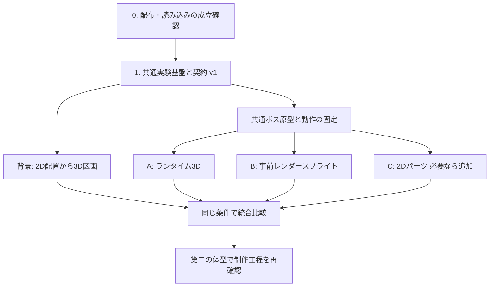

# HD-2D風の背景・大型キャラクター実験計画

調査日：2026年11月26日 JST。状態：調査・設計案。実験基盤、アセット制作、性能測定は未着手。以下の日数・容量・フレーム時間は見積もりと初期目標で、実測値ではない。

配信経路：既存Cloudflare本人専用Workerの`/hd-2d/`を使用する。配信確認用の入口とHTML集約経路を先に整備し、実験本体の実装後も同じコマンドで更新する。[ビルド・配信手順](../hd-2d/README.md)

選定条件：**商用利用を含め、購入・月額契約・売上に応じた利用料が不要なツールだけを候補にする。** 非商用限定の無料版、期間限定の体験版、有料アドオンや従量課金APIを必要とする工程は採用しない。過去の調査資料に含まれる有料製品も、今回の採用候補から除外する。

## 1. 推奨方針

**Babylon.js＋TypeScriptで小さな共通実験室を作る。背景は「2Dの配置データ＋高さ・形状の指定」から3D化する。キャラは同じオリジナルの立体原型から、ランタイム3Dと事前レンダースプライトを比較する。2Dパーツ方式を低工数の対照として加える。**

大型キャラで重くなるのは、画像の大きさそのものより、方向別・動作別の絵と、その修正を作り続ける工程。立体を制作に使えば、最終表示が2Dでも、その負担を減らせる。一方、自由な回り込み・動的な陰影・部位の奥行きが必要なら、ランタイム3Dが有利になる。最初から表示方式を一つに固定せず、同じ被写体で確かめる。

最初の制作原型は、部位を硬いまま動かす低ポリモデルを推奨する。ボクセルはその形状を作る別の手段として試し、最初から「全身を1ピクセルずつ立体化する」ことは必須にしない。顔や関節で連続した変形が必要になった場合に、スキニングを追加する。

既存の[2D→3D制作調査](2d-assets-to-animated-3d-survey-2026-11.md)はPlayCanvasを先行候補としている。今回は「HD-2D風の絵作りと大型ボスの比較」に目的を絞り、ポスト処理・影・モデル再生をまとめて試せるBabylon.jsを先行候補にする。PlayCanvasの不採用を確定する判断ではない。

## 2. 添付画像から目標を分解する

公式はHD-2Dをドット絵と3DCGの画面効果を組み合わせた表現と説明している。[OCTOPATH TRAVELER公式](https://www.jp.square-enix.com/octopathtraveler/about/)

次は添付画像の観察から立てる制作上の仮説であり、原作の内部実装を断定するものではない。

| 要素 | 実験すること |
| --- | --- |
| 小さなドットキャラと立体の街並み | キャラ・背景の輪郭とテクセル密度をそろえる。画面全体のモザイク化だけで済ませない |
| 建物・橋・階段の奥行き | 単純な3D形状と小さなテクスチャで、前後関係と落ち影を作る |
| 暖色の光と暗い周辺 | キーライト、環境光、色調整、弱いビネットを個別に調整する |
| 手前・奥のぼけと中央の読みやすさ | 被写界深度は後から加え、キャラ・攻撃予告の判読性を保つ |
| 煙・光・小物による密度 | 輪郭と陰影が成立してから足す。最初の完成条件にはしない |

第一段階は固定に近い斜め見下ろしカメラ。正投影と狭い画角の透視投影を短く比較し、一つを基準に固定する。自由回転は要求しないが、限界を調べるため左右15度と1.5倍・2倍の寄りを診断用に残す。フィールド用とボス用の2構図を用意し、スプライトを書き出す際にも投影・傾き・向きを記録する。

主人公とボスで表示方式をそろえる必要はない。小さな主人公は既存の自作2D素材を比較用に置き、ボスだけを立体化してもよい。フィールドと戦闘で表現を変える案も残す。

## 3. エンジン選定

| 候補 | 今回に合う点 | 初回の扱い |
| --- | --- | --- |
| **Babylon.js** | TS/ES modules、3Dモデル・アニメーション・影・ポスト処理を組み合わせられる | 第一候補。WebGL 2で小さく始める |
| **Three.js** | 描画の構成を細かく制御でき、公式にピクセル描画の追加パスもある | Babylonの合成処理や配布容量が障害になった場合の次候補 |
| **PlayCanvas Engine** | エディタを使わずローカルJS/TSで制作可能。過去調査との連続性がある | MITライセンスのEngine単体を対象とする。有料のクラウド機能には依存しない |
| **Godot** | シーン・アニメーションをエディタで調整する制作に向く | 無料の比較候補。ただし今回はTSと単体HTMLを優先。通常Web出力は複数ファイル |

Babylonの標準パイプラインにはBloom、被写界深度、色調整等がある。ThreeにもRenderPixelatedPassがある。いずれも「HD-2Dを自動で完成させる機能」ではなく、構成要素として使う。[Babylon公式パイプライン](https://doc.babylonjs.com/features/featuresDeepDive/postProcesses/defaultRenderingPipeline/)、[Three公式ピクセルパス](https://threejs.org/docs/pages/RenderPixelatedPass.html)

BabylonのES modulesはバンドラーを前提にできる。PlayCanvasのローカル利用も公式に案内されている。[Babylon ESM](https://doc.babylonjs.com/setup/frameworkPackages/es6Support/)、[PlayCanvas単独利用](https://developer.playcanvas.com/user-manual/engine/standalone/)、[Godot Web出力](https://docs.godotengine.org/en/stable/tutorials/export/exporting_for_web.html)

### 無料の構成と除外対象

推奨構成は、Babylon.js＋Blockbench＋Blender＋手書きマップJSON。配置編集が必要になったらTiled、ボクセル造形が必要になったらMagicaVoxelを加える。TiledとLDtkはいずれも無料・オープンソースとして提供されている。[Tiled公式](https://www.mapeditor.org/)、[LDtk公式](https://ldtk.io/)

Babylon.jsはApache-2.0、PlayCanvas EngineはMITライセンスの本体を使う。無料枠付きの有料クラウドサービスを前提とする構成にはしない。[Babylonライセンス](https://github.com/BabylonJS/Babylon.js/blob/master/license.md)、[PlayCanvas Engineライセンス](https://github.com/playcanvas/engine/blob/main/LICENSE)

RPG Paper Maker、RPGツクールU2U、RPG Developer Bakin、RPG in a Boxは今回の候補から除外する。RPG Paper Makerは非商用なら無料だが、商用にはライセンス購入が必要なため、今回の無料条件には含めない。[RPG Paper Maker公式](https://rpg-paper-maker.com/)

**今回の実験はBabylon.js一本で行う。エンジンの並列移植はしない。** まず配布と描画の条件を満たすかを確認し、失敗した条件を明示して次候補へ進む。エンジンの変更だけで、造形・関節・アニメーション制作が不要になるわけではない。

## 4. 背景：2D配置データから組み立てる

「2Dマップ」は最初に広大なワールド全体を作る意味ではなく、町・戦闘場面を定義する配置データとして扱う。まず24×24セル程度の小区画だけ作る。

```text
2D配置JSON
  地面・通行可能領域
  高さ・階段・橋の階層
  建物/木/柵等の種類・向き・寸法
  マテリアル・テクスチャ・光源
       ↓ 決定論的な変換
平面＋箱＋屋根＋階段＋薄い面のメッシュ
       ↓ 必要な対象だけ追加
小物のボクセル形状 / 手作業のGLB
```

2Dの完成画像だけでは、橋の下、屋根の裏、建物の高さは決まらない。高さ、形状種別、通行面、装飾面を別データにする。特に橋の上下は単一の高さマップでは表せないため、レイヤーまたは別オブジェクトとして記述する。

初回は小さな手書きJSONで十分。配置編集が負担になった時点でTiledのJSONとカスタムプロパティを採用し、独自の入力仕様へ変換する。LDtkもJSON出力を持つが、最初から両対応しない。[Tiled JSON](https://doc.mapeditor.org/en/stable/manual/export-generic/)、[Tiledプロパティ](https://doc.mapeditor.org/en/stable/manual/custom-properties/)、[LDtk JSON仕様](https://ldtk.io/docs/)

変換器は「任意の2D絵を完全な3D街へ変換」するものではなく、意味を持った配置を少数の形状へ置き換えるもの。床・壁・屋根を別面にしてUVを割り当てる。全景をボクセル化すると箱数と面数が増えやすいため、見えない面の削除や結合を行い、1ボクセル1描画物を避ける。

背景担当の納品条件は、地面、段差、橋またはアーチ、屋根付き建物、前景の柱、点光源が一つずつある区画。経路探索や広域ストリーミングは初回対象にしない。判定は描画メッシュから独立した地面上の簡単な2D領域にする。

## 5. キャラ：同じ原型から三方式を比較する

共通の題材は、主人公の4〜6倍の背丈を持つオリジナルの「樹皮の巨人」。胴、頭、左右の腕・脚、枝の角、手前へ伸びる大きな腕を持たせる。硬い部位でも成立し、輪郭・関節・奥行きの問題を観察しやすい。特定作品のボス絵は素材に使わない。

| 方式 | 制作と表示 | 得たい答え | 主な限界 |
| --- | --- | --- | --- |
| **A：部位別の低ポリ3D** | Blockbench/Blenderで原型・動作→GLB→Babylonで再生。小さなテクスチャと限定した色・陰影を使う | 大型ボスを立体で動かしつつ、求めるドット感と制作速度を両立できるか | 単に解像度を下げても手描きの輪郭にならない。関節、陰影、動作中のちらつきが課題 |
| **B：3Dから事前レンダー** | Aと同じ原型・動作を決めたカメラでPNG連番化→アトラス→3D空間の面で再生 | 3D制作によって、大きな2D絵の描き直しをどこまで減らせるか | 視点別・動作別の画像数、手修正、動的照明とのずれ。身体全体は一枚の面の深度になる |
| **C：2Dパーツ／限定的な厚み** | 原型から切り出した部位絵を、親子関係と支点で動かす。必要なら薄い立体にする | 固定構図のボスなら、さらに少ない工数で説得力が出るか | 強いひねりや手前への攻撃、隠れた部位、描画順の調整が増える |

最初にAを通常の3D表示で成立させ、Bの書き出し元にも使う。A/Bを必須、Cは両者の制作費を見て加える。ボクセル版はAの造形差分として扱い、表示方式と造形方式を一度に増やさない。

### ツールの役割

- **Blockbench：** 無料で、制作したモデルを商用プロジェクトにも使える。低ポリの部位・階層・動作を作る入口。アニメーションを運ぶ形式はglTF/GLBを基準とし、OBJで動作まで渡せるとは扱わない。選んだプロジェクト形式・書き出しで階層と動作が残ることを一体目で確認する。[無料・商用利用の公式FAQ](https://blockbench.net/wiki/blockbench/faq/)、[形式の公式比較](https://www.blockbench.net/wiki/guides/export-formats/)
- **Blender：** 商用を含め無料で使える。原型の修正、リグ、動作、PNG連番のレンダー、GLB出力を担う。初回は複雑な変形より部位の回転を優先する。[公式の利用条件](https://www.blender.org/about/)、[glTF出力](https://docs.blender.org/manual/en/latest/addons/scene_gltf2.html)、[連番出力](https://docs.blender.org/manual/en/latest/render/output/animation.html)
- **MagicaVoxel：** 作者があらゆるプロジェクトでの無料利用を認めているボクセル形状の制作候補。静的なOBJ等の出力と、ゲーム用の骨・動作が完成していることは分けて扱う。[公式](https://ephtracy.github.io/)、[作者の利用条件回答](https://github.com/ephtracy/ephtracy.github.io/issues/331)
- **Cの2Dパーツ／厚み：** 部位面・支点・動作JSONを実験基盤で処理するか、Blenderで部位を配置して書き出す。SpriteStack、Spine、RPG Makerの3Dキャラクターコンバーターは有料ツールのため候補から除外する。

従量課金の画像生成・画像→3D・自動リグAPIも今回の候補から外す。すでに用意できている原案やモデルは、出自と利用条件を確認して同じA/B/Cへ投入できる仕様にする。

### Bの画像量は先に見積もる

仮に256×256 RGBAを1方向あたり48フレーム、4方向使うと、生の画素は約48 MiB。512×512なら約192 MiBになる。PNGのファイル容量とは別に、展開後のGPUメモリと、追加テクスチャ・mipmap分を考える必要がある。

初回はボス用の1方向から開始し、必要なら逆向きやフィールド用を追加する。アトラスは実機の最大テクスチャ寸法に合わせて分割し、余白と足元原点を統一する。安易な左右反転で、非対称の装備や照明を壊さない。

### 影と遮蔽を比較条件に入れる

事前レンダーで固定できるのは自己陰影や身体内部の重なり。世界の建物・プレイヤーとの遮蔽まで正しく固定できるわけではない。B/Cも3Dシーン内の面として描き、透明部分はalpha testを基本とする。接地影は別の簡単な影で開始する。

板が通常の不透明物と前後することと、腕・胴・足が異なる深度で前後することは別の条件。後者が必須になれば、部位分割、深度画像、代理の3D形状などが必要になる。その追加工数もB/Cの評価に含める。影を受けるだけで平面上の陰影が不自然になる場合も記録する。

## 6. 共通実験基盤の仕様

### 最小の画面

灰色の床、階段、遮蔽確認用の柱、比較用の主人公、仮ボスから始める。方式A/B/C、動作、カメラ、光源、描画効果を切り替え、停止・コマ送り・同じ時刻へのリセットを行えるようにする。横に同時表示すると負荷が変わるため、性能測定は一方式ずつ行う。

タッチでもすべての切替を使えるUIにし、設定をJSONで保存・復元する。画面保存は同じ設定・動作時刻で行い、作品としての見た目と、効果を外した検査画像を両方残す。

### 先に固定する契約

| 項目 | 初期仕様案 |
| --- | --- |
| 座標 | 右手系、Y上、XZが地面。モデルの前方は+Z、足元中央が原点。読み込み時の変換はアダプターで一度だけ行う |
| 縮尺 | 主人公の高さ1、巨人の高さ5を基準。視線・足元・描画範囲・判定範囲を別に持つ |
| 動作 | `idle`、`windup`、`attack`、`hit`、`defeat`。合計4秒の攻撃タイムラインを共有し、命中時刻はイベントで渡す |
| カメラ | 投影・画角または正投影幅・傾き・注視点・距離を共通設定化。各方式が勝手に変更しない |
| 色と解像度 | 同じパレットと基準画面を使用。主人公とボスで世界あたりのピクセル密度を合わせる。見た目評価と低負荷設定は分ける |
| 納品形式 | Aはテクスチャ込みGLB、BはPNG＋フレームJSON、CはPNG＋部位・支点・動作JSON。制作元ファイルと出典台帳も残す |
| 読み込み | `create(context)`→インスタンス。位置・向き・動作・時刻を外から指定でき、方式変更時に`dispose()`できる |
| マップ | 2D配置、高さ/通行面、遮蔽物、光源、出現位置。描画とゲーム判定を分離 |

骨の構造は全キャラで共通化しない。巨人・四足・触手は骨格が違うため、共通にするのは動作名・時刻・イベント・座標の契約まで。異なる骨格へのモーション流用は後続実験とする。

### 描画効果を足す順序

1. 通常のメッシュ、最寄り補間の小さなテクスチャ、固定ライト、接地影だけで輪郭を評価する。
2. 色段階を絞ったマテリアル、低解像度レンダーを個別に比較する。カメラ移動・関節回転によるピクセルのちらつきも見る。
3. 弱いBloom、色調整、最後に被写界深度を追加する。UIは処理後に重ねる。
4. キャラだけを低解像度化する必要が出たら専用RenderTargetと深度を扱う。画面に後から貼るだけでは建物との遮蔽・ぼけが崩れるため、別の実験として見積もる。

Nearest補間は拡大をくっきりさせる機能で、3Dの陰影や輪郭を自動でドット絵へ設計し直す機能ではない。原寸・移動中・寄りのすべてで確認する。

## 7. リポジトリと単体HTML

設置先はリポジトリ直下の **`hd-2d/`** とする。`3min-rpg/`と並ぶ独立した実験プロジェクトとして、依存・ビルド・出力を分ける。以下の内部構成は実装時に順次作成する。

```text
hd-2d/
  README.md                   # 方針・計画書への入口
  package.json                # 実装開始時に追加する独立した依存とコマンド
  common/                     # 基盤担当：カメラ、照明、素材読込、比較制御
  contracts/                  # 親＋基盤担当：確定後は勝手に変えない
  assets/source/              # 共通原型。最初の担当が作り以後は版を固定
  maps/                       # 背景担当
  characters/runtime-3d/      # A担当
  characters/prerender/       # B担当
  characters/parts-2d/        # C担当（追加時）
  viewer/                     # 基盤担当：比較UIと測定
  tools/                      # 書き出し・埋め込み。用途別に所有者を指定
  tests/                      # 変換・アセット契約・配布物の検証
  results/                    # 同条件の画像、測定JSON、制作時間
  dist/hd2d-lab.html           # 外部通信不要の配布物（Git追跡対象外）
```

現行の`3min-rpg/scripts/build.mjs`は相対の名前付きimportだけを束ねる小型パッカーで、npmのエンジンをそのまま読めない。HD-2D実験には**`hd-2d/`内にesbuildの独立したビルド経路**を追加する。既存作品のビルド全体を最初から移行する必要はない。ルートの`build`・`test`・`typecheck`は引き続き`3min-rpg/`向けとし、HD-2D用のビルドは`hd2d:build`で実行する。現在の入口は依存不要のHTMLをコピーして出力し、エンジン導入時にそのビルド処理を拡張する。

Cloudflareへの配布では、既存ゲームのHTMLをサイト直下、HD-2DのHTMLを`/hd-2d/`配下へ集約する。`cf:check`で両プロジェクトをビルド・検証し、`cf:deploy:private`で同じ本人専用Workerへまとめて更新する。ソース・認証情報を含めず、配布ディレクトリ直下の自己完結HTMLだけを対象とする。新しいホスト名や一般公開の経路は作らない。

`hd-2d/common/`はこの実験内の共有処理。既存試作との共通化が必要になった場合だけ、利用側と出自・ライセンスを確認して共有方法を決める。既存アセットを無条件に複製しない。

実装開始時にBabylon core/loadersとesbuildの安定版を確認し、同系列の互換版をlockfileで固定する。実行時CDN、外部フォント、ネットからの素材取得は使わない。コード分割を避け、シェーダーと必要なローダーも同梱する。

GLBはHTML内のデータからメモリ上のバイナリに復元して読み込む。テクスチャもGLBまたはHTMLに内包する。初回はDraco/Meshopt/KTX2を使わず、圧縮デコーダーの追加読み込みを避ける。Babylonの公式資料でも、これらのデコーダーは既定でCDNを利用する場合があると説明されている。[Babylon glTFとデコーダー](https://doc.babylonjs.com/features/featuresDeepDive/importers/glTF/)

現行CSPは`connect-src 'none'`、画像に`data:`/`blob:`を許可する。モデルをURL経由でfetchする読み方とは衝突するため、メモリ入力で動く経路を最初に検証する。Babylon公式は、メモリ上のGLB画像と、URLとしての`blob:`読み込みを区別している。[GLB画像とCSP](https://doc.babylonjs.com/features/featuresDeepDive/importers/glTF/#content-security-policy-for-embedded-images)

実験だけのために既存作品全体のCSPを緩めない。オフライン・`file://`・実際の静的配信の三条件で確認する。スマホは同じ内包HTMLを静的配信して実機検証する。画像版を採用しても背景は3Dなので、実験全体からWebGLが不要になるわけではない。

## 8. 作業順と並列化



以下は担当1人の実作業日を単位とする概算。習熟と素材修正で変動し、並列化した壁時計日数とは異なる。初期比較は、0〜2と背景・A・B・統合で合計約7〜14人日を見込む。

| 段階 | 目安 | 完了条件 |
| --- | --- | --- |
| 0. 技術スパイク | 0.5〜1日 | 最小メッシュ＋テクスチャ＋1動作のGLBを単体HTMLで再生。オフライン/CSPを確認 |
| 1. 共通基盤 | 1〜2日 | 構図、照明、時刻、方式を切替。停止・設定保存・測定が動く。仮アセットで契約v1固定 |
| 2. 共通原型 | 1〜2日 | 巨人一体と5動作。通常3Dで輪郭を確認。元ファイル・GLB・基準設定を固定 |
| 背景トラック | 1〜2日 | JSONから区画生成。段差・柱・屋根の前後関係と影を確認 |
| Aトラック | 1〜2日 | 同じ原型を直接再生し、通常/色数制限/低解像度を比較 |
| Bトラック | 1.5〜3日 | 同じ原型を1方向から連番化。アトラス、接地影、手修正時間を記録 |
| Cトラック（任意） | 1〜2日 | 同じ題材の部位面で待機・攻撃を再生。ひねりと描画順の限界を記録 |
| 統合・選定 | 1〜2日 | PC・スマホの同条件比較と結果表。方式別に採用/保留の理由を残す |

並列に着手できるのは、契約v1が固まり、キャラ側には共通原型が渡った後。B/Cは原型完成まで固有の作画を先行させず、仮素材で読込経路だけ確認できるようにする。

### 担当の境界

- 親：仕様確定、共通原型の承認、エンジン選定、最終比較。共通契約の変更を取りまとめる。
- 基盤担当：`hd-2d/`内の`common/`、`contracts/`、`viewer/`とビルド経路。背景・各方式の実装に立ち入らない。
- 背景担当：`maps/`と背景専用素材・変換処理。カメラや光源の共通既定値を変更しない。
- A/B/C担当：各方式のディレクトリと専用の書き出し処理。共通原型を変更したい場合は差分を提案し、比較対象全体の版を更新する。

各作業依頼には、対象ファイル、入力アセットの版、受入条件、検証条件を渡す。他担当の変更を戻さず、共有ファイルは所有者が統合する。最初の基盤実装は1担当に集約し、その後の独立トラックを並行する。

## 9. 比較と採用基準

### 同じ場面で必ず確認すること

| 観点 | 確認内容 |
| --- | --- |
| 大きさと読みやすさ | 主人公との4〜6倍差、画面占有率、顔・腕・攻撃方向が分かるか。小さな画面でも足元が見えるか |
| 動作 | 待機、予備動作、攻撃、被弾、倒れる。停止画だけでなく移動・回転中の輪郭を見る |
| 前後関係 | 主人公が手前・背後・足元に来る。柱が胴と腕の間を通る条件も確認する |
| 光と影 | 昼/暗所、横からの光、接地影、伸びた腕の影、身体と地面の関係 |
| 画面効果 | 効果なし、色調整、Bloom、DOFの順で比較。ぼけで欠点を隠さない |
| 制作効率 | 原型、動作追加、レンダー、輪郭修正、統合に分けて時間を記録。待機以外の動作を追加する費用を重視 |
| 容量と速度 | HTML実バイト、展開後画像の概算、初回表示、フレーム時間p50/p95、5分後の安定性 |

初期目標はPCで60fps級、スマホの低負荷設定で30fps級。p95フレーム時間はそれぞれ約16.7ms/33.3msを目安とし、ウォームアップ後60秒を同じ設定・操作・端末で測る。低解像度RT、影、DOF等を順に切って原因を分ける。スマホ縦画面では構図を引き、ボスと操作ボタンが重ならないことも確認する。

実験HTMLの初期容量目安は10 MiB以下とするが、これはエンジン容量の実測予測ではない。0の時点で空のエンジンとモデルを測り、アセットに使える予算を決め直す。画像シートの総画素数とGPUメモリを別に追う。

PCはChromeを基準に、スマホは可能ならiOS SafariとAndroid Chromeの各実機で確認する。実機がない項目は未検証として残し、エミュレーションだけで合格としない。ブラウザ・端末・OS・描画設定・アセット版を結果に記録する。

### 採用の分岐

- **Aを採用：** 大型ボスの輪郭が十分よく、低負荷設定で安定し、動作追加が楽。視点変更や部位の奥行きを今後使いたい。
- **Bを採用：** 固定構図で狙う絵に最も近く、手修正と画像量が許容範囲。ライティング・遮蔽の制約をゲーム仕様として受け入れられる。
- **Cを採用：** 少ない部位で十分な迫力が出て、ひねりの少ないボス演出を速く量産できる。
- **混在を採用：** 主人公は2D、ボスはA、会話用の絵はBなど、用途ごとに選ぶ。方式統一そのものを目的にしない。

最初の巨人だけで量産可能と結論しない。有力方式で次に四足または触手型を一体試し、共通化できる工程と体型ごとの工程を切り分ける。その結果で本制作へ進む。

## 10. 最初に実装する範囲

次の開発単位は**段階0＋1**。単体HTMLで外部通信なく動く床・柱・仮ボス、通常3Dと仮スプライトの切替、固定カメラ、光源・効果・時刻の制御までを作る。仮ボスには単純な部位の回転でも実際のGLB動作を一つ含め、静的表示だけで終えない。

それが通れば共通原型と背景に着手し、原型の固定後にA/Bを並行する。この時点では戦闘ルール、オンライン機能、既存ゲームのエンジン移行は追加しない。素材とエンジンのライセンス表示、モデル・テクスチャ・生成元の出典台帳を配布時まで維持する。
